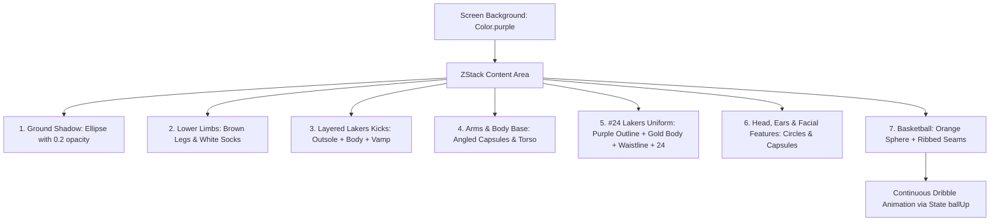
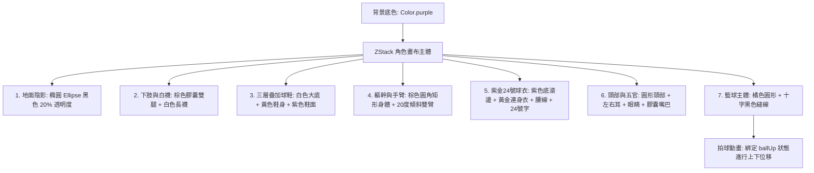

<div align="center">

# 🏀 Kobe Bryant — SwiftUI Tribute 💜💛

<p align="center">
  <b>"Heroes come and go, but legends are forever." — Kobe Bryant (1978–2020)</b>
</p>

<p align="center">
  An artistic character illustration and interactive animation celebrating the Black Mamba, crafted entirely with pure SwiftUI code — zero external image assets or third-party dependencies.
</p>

<!-- Language Switcher Anchor Navigation -->
<p align="center">
  <a href="#english"></a>
  &nbsp;
  <a href="#chinese"></a>
</p>

---

<!-- Badges -->
<p align="center">
  
  
  
  
  
  
</p>

</div>

---

<a id="english"></a>
## 🇺🇸 English

<p align="right">
  <a href="#chinese">🌐 切換至繁體中文 (Switch to Traditional Chinese) ➔</a>
</p>

### 📑 Table of Contents
1. [📖 Overview](#-overview)
2. [✨ Key Highlights](#-key-highlights)
3. [🎨 Visual Layer Breakdown](#-visual-layer-breakdown)
4. [📐 Custom Geometry: BasketballUniformShape](#-custom-geometry-basketballuniformshape)
5. [🏀 Dynamic Bouncing Animation](#-dynamic-bouncing-animation)
6. [🎨 Lakers Color Palette](#-lakers-color-palette)
7. [📂 Project Structure](#-project-structure)
8. [🚀 Getting Started & Requirements](#-getting-started--requirements)
9. [🐍 Mamba Mentality Quotes](#-mamba-mentality-quotes)

---

### 📖 Overview

This project is a dedicated **SwiftUI visual artwork** paying homage to NBA legend **Kobe Bryant**. Built from the ground up without raster images or SVG imports, every single element — from the iconic Los Angeles Lakers #24 jersey, the signature low-top sneakers, to the bouncing basketball — is rendered with declarative SwiftUI shapes, custom Bezier paths, and implicit animations.

---

### ✨ Key Highlights

- **💯 100% Native SwiftUI**: Zero third-party dependencies, zero static PNG/JPG/SVG assets. Built purely with `Shape`, `Path`, `Circle`, `Capsule`, and `RoundedRectangle`.
- **✂️ Bespoke Geometry (`BasketballUniformShape`)**: A custom continuous jersey-and-shorts shape featuring excavated armholes via circular arcs, side slits, and a contoured crotch notch.
- **🏀 Kinetic Dribbling Animation**: Smooth, uninterrupted basketball bouncing powered by SwiftUI's `.easeInOut` with autoreversing infinite repetition.
- **👟 Layered Kobe Sneaker Silhouette**: Faithfully composed triple-layer sneaker construction (white midsole outsole, Lakers gold body, Lakers purple vamp).
- **💜 Authentic Lakers Color Palette**: Asset catalog-defined Lakers Gold (`#FDB927`) and Lakers Purple (`#552583`) for accurate team aesthetics.

---

### 🎨 Visual Layer Breakdown

The artwork is structured inside a multi-layered `ZStack` adhering to depth ordering from background to foreground:



---

### 📐 Custom Geometry: BasketballUniformShape

Rather than assembling separate disjointed rectangles for jersey and shorts, `BasketballUniformShape` crafts a unified silhouette in one continuous closed path:

```swift
struct BasketballUniformShape: Shape {
    func path(in rect: CGRect) -> Path {
        var path = Path()
        let w = rect.width, h = rect.height
        let r: CGFloat = 22                 // Armhole cutout radius
        let armholeCenterY: CGFloat = h * 0.20
        let slitW: CGFloat = 10             // Shorts side slit width
        let slitH: CGFloat = 14             // Shorts side slit height
        let crotchW: CGFloat = 18           // Crotch inseam notch width
        let crotchH: CGFloat = 24           // Crotch inseam notch height
        
        // 1. Shoulders & neckline
        path.move(to: CGPoint(x: 0, y: 0))
        path.addLine(to: CGPoint(x: w, y: 0))
        path.addLine(to: CGPoint(x: w, y: armholeCenterY - r))
        
        // 2. Right armhole excavation
        path.addArc(center: CGPoint(x: w, y: armholeCenterY), radius: r,
                    startAngle: .degrees(270), endAngle: .degrees(90), clockwise: true)
        
        // 3. Right shorts side slit & inseam
        path.addLine(to: CGPoint(x: w, y: h - slitH))
        path.addLine(to: CGPoint(x: w - slitW, y: h))
        path.addLine(to: CGPoint(x: w * 0.5 + crotchW * 0.5, y: h))
        
        // 4. Inseam crotch arch
        path.addLine(to: CGPoint(x: w * 0.5, y: h - crotchH))
        path.addLine(to: CGPoint(x: w * 0.5 - crotchW * 0.5, y: h))
        
        // 5. Left shorts side slit & armhole excavation
        path.addLine(to: CGPoint(x: slitW, y: h))
        path.addLine(to: CGPoint(x: 0, y: h - slitH))
        path.addLine(to: CGPoint(x: 0, y: armholeCenterY + r))
        path.addArc(center: CGPoint(x: 0, y: armholeCenterY), radius: r,
                    startAngle: .degrees(90), endAngle: .degrees(270), clockwise: true)
        
        path.closeSubpath()
        return path
    }
}
```

---

### 🏀 Dynamic Bouncing Animation

The rhythmic basketball dribble leverages a lightweight `@State` toggle coupled with a smooth autoreversing tween:

```swift
@State private var ballUp = false

// In body:
.offset(x: -125, y: ballUp ? 130 : 190)
.onAppear {
    withAnimation(
        .easeInOut(duration: 0.6)
        .repeatForever(autoreverses: true)
    ) {
        ballUp = true
    }
}
```

---

### 🎨 Lakers Color Palette

| Token / Asset | Hex Code | Preview | Description |
|:---|:---:|:---:|:---|
| `LakersPurple` | `#59268C` / `#552583` |  | Signature Forum Purple jersey trim, shoes & number |
| `LakersGold` | `#FDC531` / `#FDB927` |  | Showtime Gold jersey base & sneaker body |
| `Color.brown` | `#99582A` |  | Character skin tone & limbs |
| `Color.orange` | `#FF6600` |  | Regulation basketball leather |
| `Color.white` | `#FFFFFF` |  | Athletic crew socks & sneaker outsoles |

---

### 📂 Project Structure

```
Kobe/
├── Kobe.xcodeproj/                 # Xcode Project Configuration
│   ├── project.pbxproj
│   └── project.xcworkspace
├── Kobe/
│   ├── MyApp.swift                 # Application Lifecycle Entry (@main)
│   ├── ContentView.swift           # Main Canvas: Character, Shapes & Animations
│   └── Assets.xcassets/            # Asset Catalog
│       ├── AccentColor.colorset
│       ├── LakersGold.colorset     # Lakers Gold Color Token
│       └── LakersPurple.colorset   # Lakers Purple Color Token
└── README.md                       # Bilingual Documentation
```

---

### 🚀 Getting Started & Requirements

- **macOS**: Sonoma 14.0 or later
- **Xcode**: 15.0 or later
- **Swift**: 5.9 or later
- **Deployment Target**: iOS 17.0+ / iPadOS 17.0+ / macOS 14.0+

#### Quick Run in Xcode:
1. Clone the repository:
   ```bash
   git clone https://github.com/david950520/Kobe.git
   cd Kobe
   ```
2. Open `Kobe.xcodeproj` in Xcode:
   ```bash
   open Kobe.xcodeproj
   ```
3. Open `ContentView.swift` and press **Option + Command + P** (`⌥ + ⌘ + P`) to trigger **Xcode Canvas Previews**, or choose an iOS Simulator (e.g., iPhone 15 Pro) and hit **Command + R** (`⌘ + R`) to run.

---

### 🐍 Mamba Mentality Quotes

> *"I have self-doubt. I have insecurity. I have fear of failure. I have nights when I show up at the arena and I'm like, 'My back hurts, my feet hurt, my knees hurt. I don't have it. I just want to chill.' We all have self-doubt. You don't deny it, but you also don't capitulate to it. You embrace it."*
>
> **— Kobe Bryant (1978 – 2020)**

<div align="center">
  <p>
    <a href="#english">⬆️ Back to Top</a> • 
    <a href="#chinese">🌐 切換至繁體中文</a>
  </p>
</div>

---

<a id="chinese"></a>
## 🇹🇼 繁體中文

<p align="right">
  <a href="#english">🌐 Switch to English (切換至英文版) ➔</a>
</p>

### 📑 目錄導覽
1. [📖 專案簡介](#-專案簡介)
2. [✨ 核心亮點](#-核心亮點)
3. [🎨 視覺圖層架構剖析](#-視覺圖層架構剖析)
4. [📐 自訂幾何圖形：BasketballUniformShape](#-自訂幾何圖形basketballuniformshape)
5. [🏀 動態拍球動畫實作](#-動態拍球動畫實作)
6. [🎨 湖人經典配色表](#-湖人經典配色表)
7. [📂 專案檔案結構](#-專案檔案結構)
8. [🚀 快速開始與環境需求](#-快速開始與環境需求)
9. [🐍 曼巴精神經典名言](#-曼巴精神經典名言)

---

### 📖 專案簡介

本專案是一個以純 **SwiftUI 向量幾何繪圖與動畫** 致敬傳奇籃球巨星 **Kobe Bryant**（柯比·布萊恩）的創意藝術作品。全專案**完全不依賴任何外部點陣圖、SVG 圖片或第三方套件**，完全透過 SwiftUI 原生宣告式語法，以精密的幾何形狀、自訂貝茲路徑曲線與流暢的隱式動畫，刻劃出紫金軍團 24 號標誌性身影與生動的拍球姿態。

---

### ✨ 核心亮點

- **💯 100% 純原生 SwiftUI 刻畫**：全視圖不使用任何 PNG/JPG/SVG 圖檔，完全以 `Shape`、`Path`、`Circle`、`Capsule` 與 `RoundedRectangle` 幾何堆疊實現。
- **✂️ 自訂球衣版型 (`BasketballUniformShape`)**：打造專屬連身球衣與球褲路徑，包含圓弧袖孔挖空（Arc）、短褲兩側開衩（Slit）與褲襠分岔凹槽（Crotch）。
- **🏀 流暢無間斷拍球循環**：使用 SwiftUI 狀態變數搭配 `.easeInOut(duration: 0.6).repeatForever(autoreverses: true)`，重現栩栩如生的動態運球手感。
- **👟 三層立體球鞋結構**：精密疊加白色外底（Outsole）、湖人金鞋身（Body）與紫金鞋面（Vamp），還原經典低筒籃球鞋神韻。
- **💜 官方紫金專屬色票**：於 Assets 色彩庫中配置標準 Lakers Gold（`#FDB927`）與 Lakers Purple（`#552583`），呈現最道地的洛杉磯湖人隊球衣視覺。

---

### 🎨 視覺圖層架構剖析

整個畫面在 `ZStack` 中依照由底至頂的景深順序層層堆疊：



---

### 📐 自訂幾何圖形：BasketballUniformShape

為了避免衣物與短褲在視覺上產生接縫落差，本專案實作了遵循 `Shape` 協議的 `BasketballUniformShape`，以連續閉合路徑一體成型繪製：

```swift
// 籃球球衣版型
struct BasketballUniformShape: Shape {
    func path(in rect: CGRect) -> Path {
        var path = Path()
        let w = rect.width, h = rect.height
        let r: CGFloat = 22                 // 兩側袖孔半圓挖空半徑
        let armholeCenterY: CGFloat = h * 0.20 // 袖孔中心 Y 座標
        let slitW: CGFloat = 10             // 短褲兩側開衩寬度
        let slitH: CGFloat = 14             // 短褲兩側開衩高度
        let crotchW: CGFloat = 18           // 褲襠分岔寬度
        let crotchH: CGFloat = 24           // 褲襠向上分岔高度
        
        // 1. 頂部肩膀（由左上角 (0,0) 開始）
        path.move(to: CGPoint(x: 0, y: 0))
        path.addLine(to: CGPoint(x: w, y: 0))
        path.addLine(to: CGPoint(x: w, y: armholeCenterY - r))
        
        // 2. 右側袖孔挖半圓形
        path.addArc(center: CGPoint(x: w, y: armholeCenterY), radius: r,
                    startAngle: .degrees(270), endAngle: .degrees(90), clockwise: true)
        
        // 3. 右褲管外側開衩
        path.addLine(to: CGPoint(x: w, y: h - slitH))
        path.addLine(to: CGPoint(x: w - slitW, y: h))
        path.addLine(to: CGPoint(x: w * 0.5 + crotchW * 0.5, y: h))
        
        // 4. 褲襠中間向上凹入分岔
        path.addLine(to: CGPoint(x: w * 0.5, y: h - crotchH))
        path.addLine(to: CGPoint(x: w * 0.5 - crotchW * 0.5, y: h))
        
        // 5. 左褲管下擺、外側開衩與左袖孔挖空
        path.addLine(to: CGPoint(x: slitW, y: h))
        path.addLine(to: CGPoint(x: 0, y: h - slitH))
        path.addLine(to: CGPoint(x: 0, y: armholeCenterY + r))
        path.addArc(center: CGPoint(x: 0, y: armholeCenterY), radius: r,
                    startAngle: .degrees(90), endAngle: .degrees(270), clockwise: true)
        
        path.closeSubpath()
        return path
    }
}
```

---

### 🏀 動態拍球動畫實作

透過 `@State` 狀態控制籃球的垂直位移（Y 軸），在視圖載入時啟動自動反向的往復彈跳動畫：

```swift
@State private var ballUp = false

// 在 body 畫面中：
.offset(
    x: -125,
    y: ballUp ? 130 : 190  // 運球高低差 60pt
)
.onAppear {
    withAnimation(
        .easeInOut(duration: 0.6)
        .repeatForever(autoreverses: true)
    ) {
        ballUp = true
    }
}
```

---

### 🎨 湖人經典配色表

| 色彩名稱 / 代碼 | 十六進位色碼 (Hex) | 預覽色塊 | 應用區域與設計意涵 |
|:---|:---:|:---:|:---|
| `LakersPurple` | `#59268C` / `#552583` |  | 湖人標誌性紫金滾邊、背號 24 與球鞋點綴 |
| `LakersGold` | `#FDC531` / `#FDB927` |  | 主場黃金球衣主體與球鞋鞋身 |
| `Color.brown` | `#99582A` |  | 角色膚色、四肢手臂與頭部 |
| `Color.orange` | `#FF6600` |  | 經典籃球皮革色澤 |
| `Color.white` | `#FFFFFF` |  | 運動白襪與球鞋緩震大底 |

---

### 📂 專案檔案結構

```
Kobe/
├── Kobe.xcodeproj/                 # Xcode 專案工程檔
│   ├── project.pbxproj
│   └── project.xcworkspace
├── Kobe/
│   ├── MyApp.swift                 # 應用程式啟動點 (@main)
│   ├── ContentView.swift           # 主畫布：人物幾何繪製與拍球動畫
│   └── Assets.xcassets/            # 資源目錄
│       ├── AccentColor.colorset
│       ├── LakersGold.colorset     # 湖人金色票定義
│       └── LakersPurple.colorset   # 湖人紫色票定義
└── README.md                       # 雙語專案說明文件
```

---

### 🚀 快速開始與環境需求

- **作業系統**：macOS Sonoma 14.0 或更新版本
- **開發工具**：Xcode 15.0 或更新版本
- **程式語言**：Swift 5.9+
- **支援平台**：iOS 17.0+ / iPadOS 17.0+ / macOS 14.0+

#### 在 Xcode 中開啟與執行：
1. 複製專案至本機：
   ```bash
   git clone https://github.com/david950520/Kobe.git
   cd Kobe
   ```
2. 開啟 Xcode 專案：
   ```bash
   open Kobe.xcodeproj
   ```
3. 進入 `ContentView.swift` 點擊快捷鍵 **Option + Command + P**（`⌥ + ⌘ + P`）即時預覽 SwiftUI Canvas；或選擇 iOS 模擬器並按下 **Command + R**（`⌘ + R`）直接編譯執行。

---

### 🐍 曼巴精神經典名言

> *"The most important thing is to try and inspire people so that they can be great in whatever they want to do."*
>
> 「最重要的事情是努力去激勵他人，讓他們在任何想做的事情上都能成就卓越。」
>
> **— Kobe Bryant (1978 – 2020) 🏀 Mamba Forever 💜💛**

<div align="center">
  <p>
    <a href="#chinese">⬆️ 回到頂部</a> • 
    <a href="#english">🌐 Switch to English</a>
  </p>
</div>
